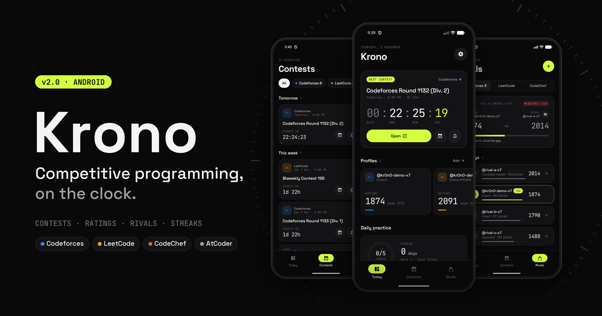
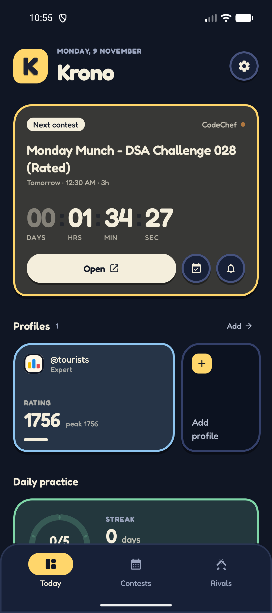
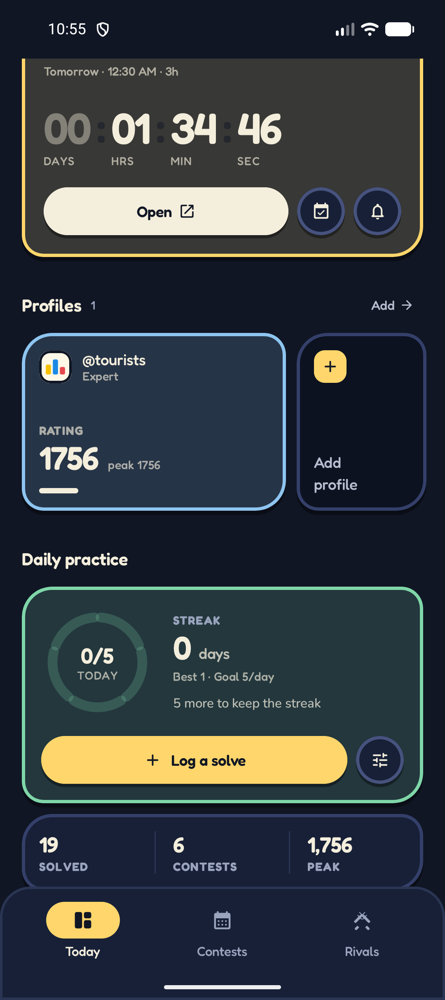
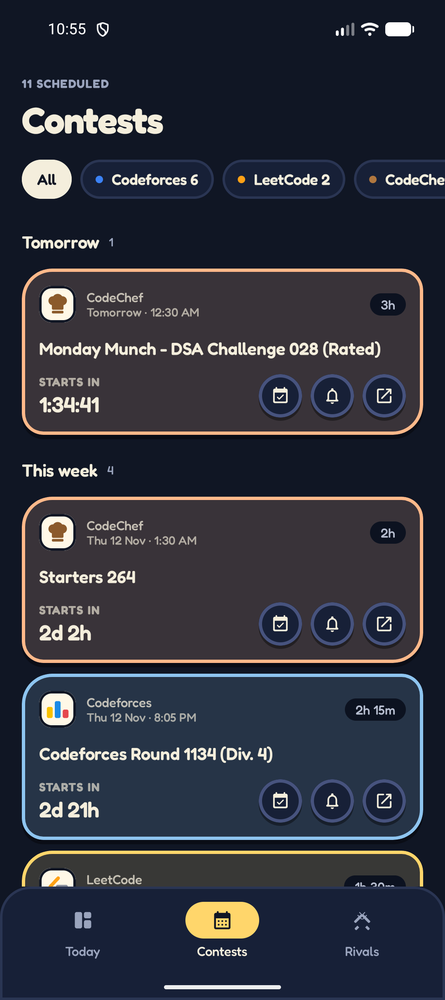
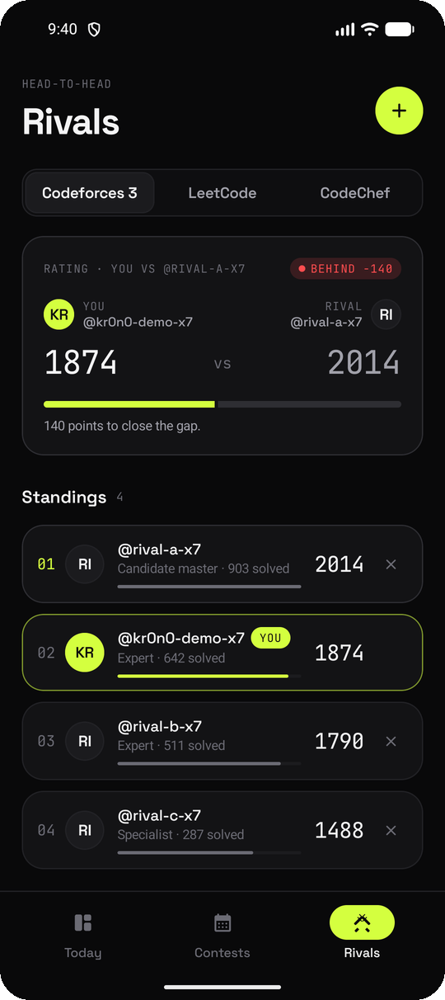
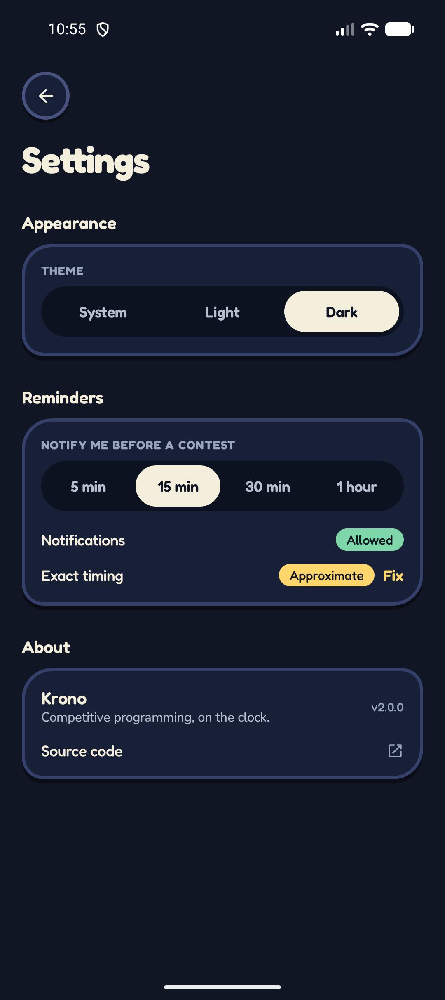
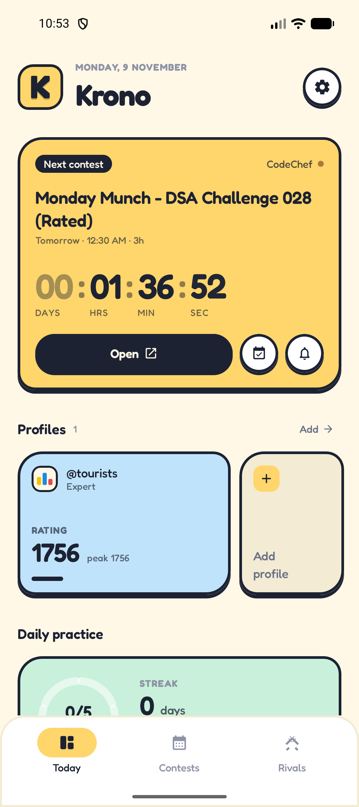

<p align="center">
  
</p>

<h1 align="center">Krono</h1>

<p align="center">
  <strong>Competitive programming, on the clock.</strong><br />
  One countdown for every contest, your ratings across platforms, and a head-to-head with your rivals.
</p>

<p align="center">
  <a href="https://github.com/MeetThakur/Krono/releases/latest"></a>
  <a href="https://github.com/MeetThakur/Krono/actions/workflows/ci.yml"></a>
  <a href="LICENSE"></a>
  
  
  
  
  
  
  
</p>

---

## Download

<p align="center">
  <a href="https://github.com/MeetThakur/Krono/releases/latest">
    
  </a>
</p>

- **Direct APK** — grab `app-release.apk` from [GitHub Releases](https://github.com/MeetThakur/Krono/releases/latest) and install it (Android 8.0+ / API 26+).
- **Auto-updates with Obtainium**
  1. Open [Obtainium](https://github.com/ImranR98/Obtainium) on your device.
  2. Tap **Add App** and paste `https://github.com/MeetThakur/Krono`.
  3. Obtainium tracks new releases and installs them for you.

---

## Screenshots

<p align="center">
  
  
  
</p>
<p align="center">
  
  
  
</p>

<sub>Screenshots use synthetic demo accounts.</sub>

---

## Features

- **Next-contest chronograph** — The Today screen counts down to the next round (or the end of a live one) to the second, with one-tap open, calendar export and reminder.
- **Unified contest schedule** — Codeforces, LeetCode, CodeChef and AtCoder in one timezone-aware list, grouped into Live / Today / Tomorrow / This week / Later, with per-platform filters and live progress bars for running contests.
- **Reliable reminders** — Alarms are armed the moment you tap the bell (and cancelled when you untap it), honour your lead time (5 min – 1 hour), survive reboots, and ask for notification permission on Android 13+. Settings shows whether notifications and exact timing are actually allowed, with a one-tap fix.
- **Profiles & real rating history** — Connect Codeforces, LeetCode and CodeChef handles to sync rating, peak, rank, solved and contest counts. Profile sheets chart your real rating history from Codeforces and LeetCode.
- **Daily practice** — A bezel-style goal dial, streaks that break correctly when you miss a day, and an undo for accidental logs.
- **Rivals** — Head-to-head comparison with gap-to-close, plus ranked standings per platform. Tap to compare, long-press or ✕ to remove.
- **Your look** — Light, dark or system theme; seven accents (Volt, Ember, Ice, Iris, Rose, Mint, Mono) or Material You wallpaper colours.

---

## Design

Krono 2.0 is built around a precision-instrument idea: flat ink surfaces, hairline borders and a single signal accent, with every number set in a tabular monospace so ratings and timers read like a readout.

| Token | Choice |
| :--- | :--- |
| Display & UI type | Space Grotesk |
| Numbers & timers | JetBrains Mono, tabular figures |
| Surfaces (dark) | Ink `#09090A` → `#131315` → `#1B1B1E`, hairlines `#222226` |
| Signal accent | Volt `#D4FF3F` (swap in Settings) |

All colours come from `KronoColors` tokens (`core/theme/Color.kt`), so both themes and every accent stay consistent.

---

## Tech Stack

| Layer | Technology | Description |
| :--- | :--- | :--- |
| **Language** | Kotlin 2.1.0 | 100% native modern Kotlin with Coroutines & Flow |
| **UI Framework** | Jetpack Compose + Material 3 | Declarative UI with Material 3 Expressive components |
| **Architecture** | MVVM + Clean Architecture | Unidirectional data flow with ViewModel and StateFlow |
| **Dependency Injection** | Hilt (Dagger) | Compile-time dependency injection across components |
| **Local Storage** | Room Database + DataStore | SQLite abstraction for relational data & Proto DataStore for preferences |
| **Networking** | Retrofit + OkHttp + kotlinx.serialization | Asynchronous HTTP client with JSON serialization |
| **Background Tasks** | WorkManager | Guaranteed periodic background sync for contest listings |
| **Build System** | Gradle Kotlin DSL (KTS) | Version catalogs (`libs.versions.toml`), Android Gradle Plugin 8.8.2 |

---

## Project Structure

```text
app/src/main/java/com/meet11/krono/
├── core/
│   ├── designsystem/          # Primitives (KronoCard, Tag, chips, buttons) + ContestCard, NextContestHero, GoalDial, RatingChart
│   ├── theme/                 # KronoColors tokens, accents, Space Grotesk / JetBrains Mono type, shapes
│   ├── ui/                    # Snackbar messages, notification-permission gate, ticker flow
│   └── util/                  # Locale-aware time formatting, countdowns, user-facing error messages
├── data/
│   ├── local/                 # Room database, entities, DAOs
│   ├── preferences/           # DataStore preferences
│   ├── remote/                # Retrofit APIs, DTOs, CodeChef parser, shared ProfileFetcher
│   └── repository/            # Repository implementations
├── di/                        # Hilt modules
├── domain/                    # Models and repository interfaces
├── presentation/
│   ├── home/                  # Today: chronograph, profiles, daily goal, POTD, coming up
│   ├── contests/              # Grouped schedule with filters
│   ├── rivals/                # Head-to-head and standings
│   ├── settings/              # Appearance, reminders, permission health
│   ├── common/                # Shared bottom sheets (add handle, daily goal)
│   └── navigation/            # NavHost with transitions, bottom bar
├── worker/                    # Sync worker, ReminderScheduler, alarm + boot receivers
├── KronoApplication.kt
└── MainActivity.kt
```

---

## Getting Started

### Prerequisites

- **Android Studio** Ladybug (2024.2+) or newer
- **JDK 17** (bundled with Android Studio)
- **Android SDK** with `compileSdk 35` and `minSdk 26`
- Android device or emulator running Android 8.0+ (API 26+)

### Setup & Run

```bash
# 1. Clone the repository
git clone https://github.com/MeetThakur/Krono.git
cd Krono

# 2. Build debug APK
./gradlew assembleDebug

# 3. Install on connected device / emulator
./gradlew installDebug
```

You can also simply open the project in **Android Studio** and click **Run** (`Ctrl+R` / `Shift+F10`).

---

## Building APKs

Build directly from the command line using the Gradle wrapper:

```bash
# Debug APK (signed with debug keystore)
./gradlew assembleDebug

# Release APK (R8-minified and resource-shrunk, ~2 MB)
./gradlew assembleRelease
```

Release builds are signed with the keystore given by `KRONO_KEYSTORE_PATH`, `KRONO_KEYSTORE_PASSWORD`, `KRONO_KEY_ALIAS` and `KRONO_KEY_PASSWORD`. Published releases must use the **same certificate as Krono 1.x** (the `debug.keystore` committed at tag `v1.6.5`), otherwise Android will not install them as an update and users would lose their data. Without those variables Gradle falls back to your local debug key, which is fine for development but can never update a published release.

### Publishing a release

1. Bump `versionCode` / `versionName` in `app/build.gradle.kts` and add a `## [vX.Y.Z]` section to `CHANGELOG.md`.
2. Push a matching tag: `git tag v2.0.0 && git push origin v2.0.0`.
3. The **Release** workflow checks the tag matches `versionName`, builds a signed APK, verifies its certificate fingerprint matches Krono 1.x, and publishes it with that CHANGELOG section as notes.

Repository secrets used by the workflow: `KRONO_KEYSTORE_BASE64`, `KRONO_KEYSTORE_PASSWORD` (`android`), `KRONO_KEY_ALIAS` (`androiddebugkey`), `KRONO_KEY_PASSWORD` (`android`).

Generated outputs:
- **Debug:** `app/build/outputs/apk/debug/app-debug.apk`
- **Release:** `app/build/outputs/apk/release/app-release.apk`

---

## Settings

- **Theme** — System, Light or Dark.
- **Accent** — Volt, Ember, Ice, Iris, Rose, Mint or Mono; or *Match wallpaper* for Material You.
- **Reminder lead time** — 5, 15, 30 or 60 minutes before start. Changing it re-arms existing reminders.
- **Reminder health** — Shows whether notifications and exact alarms are allowed, with a shortcut to fix each.
- **Daily goal** — Set from the Today screen (1–99 problems per day).

Contest schedules sync in the background every 6 hours and on pull-to-refresh.

---

## License

This project is licensed under the **GNU General Public License v3.0** (GPLv3) — see the [LICENSE](LICENSE) file for details.

---

Made with ❤️ by Meet
