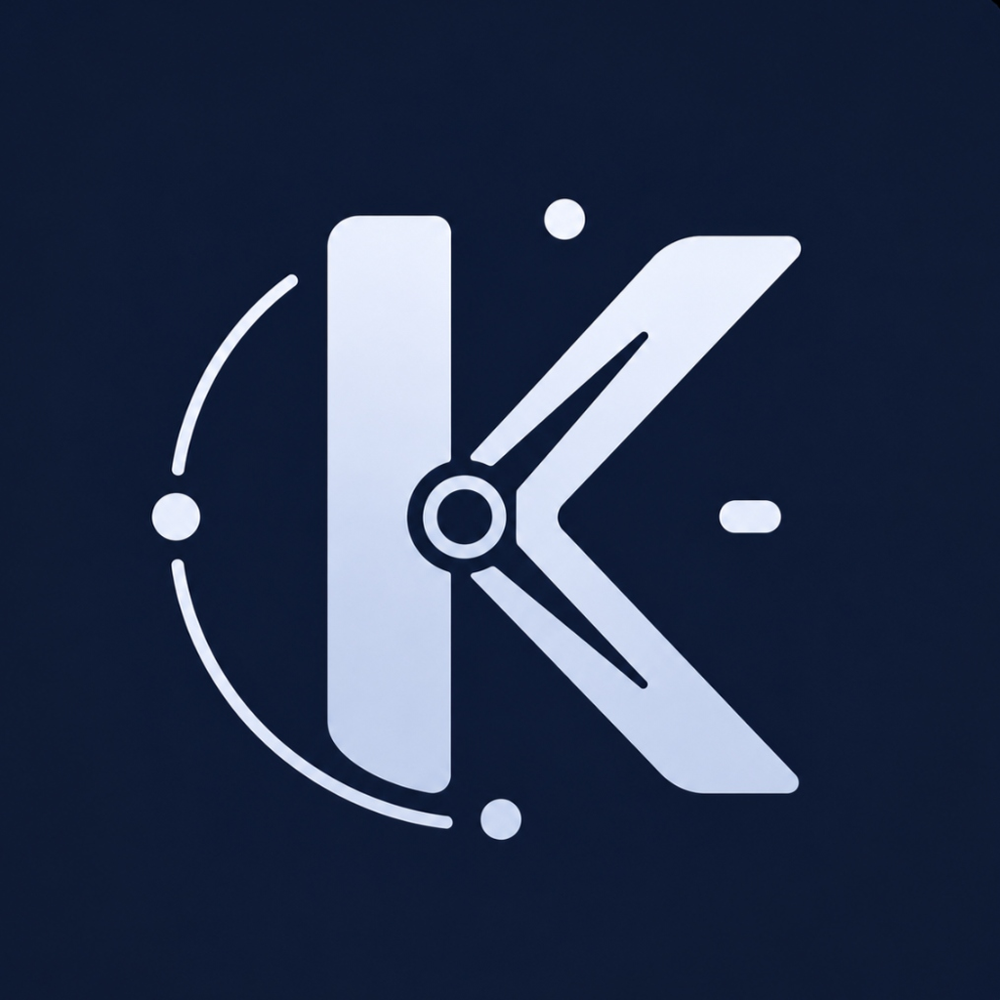
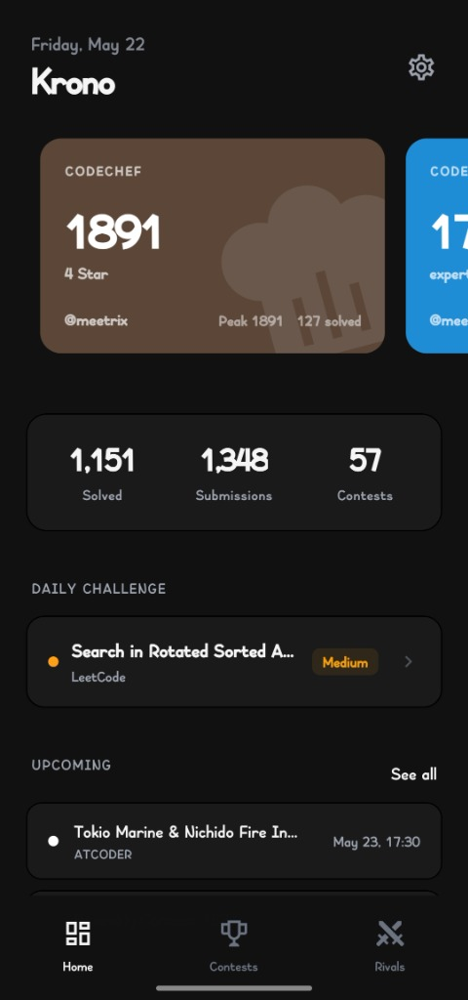
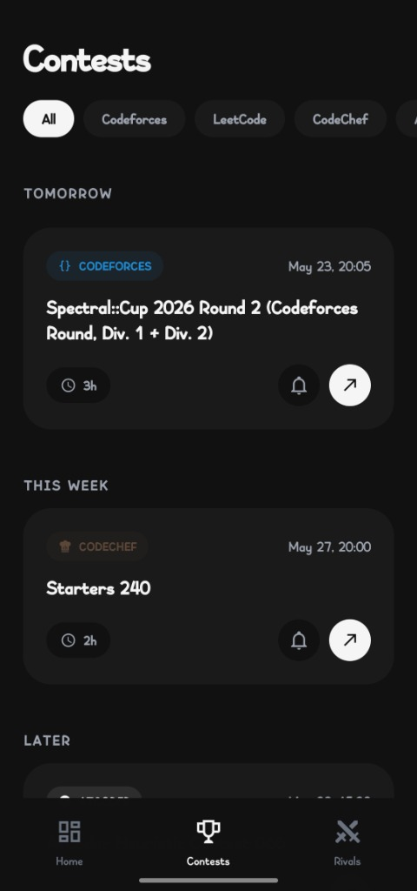
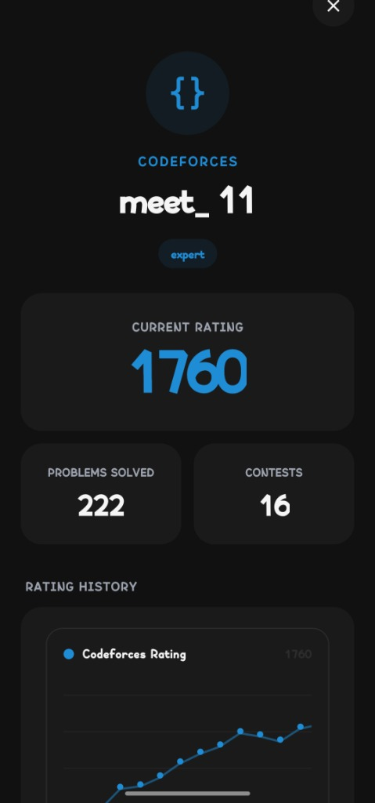
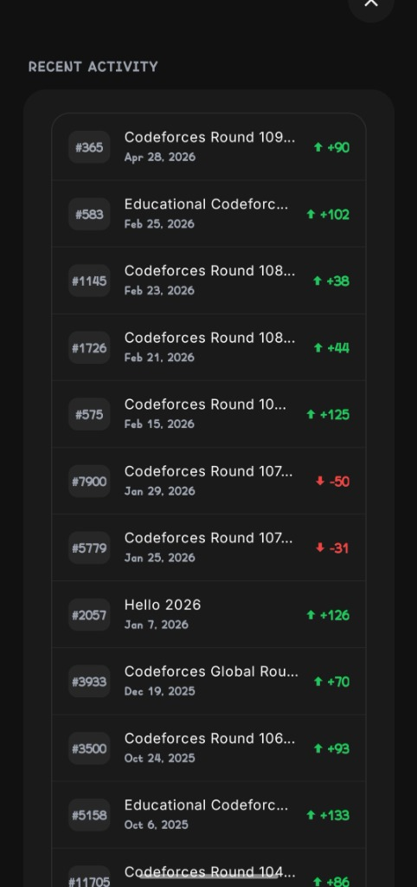
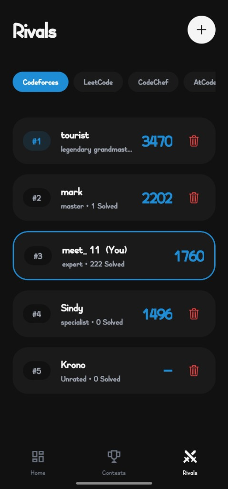

<p align="center">
  
</p>

<h1 align="center">Krono</h1>

<p align="center">
  <strong>The ultimate competitive programming companion.</strong><br />
  Track contests, sync profiles, compare ratings with rivals, and analyze performance across platforms in real-time.
</p>

<p align="center">
  
  
  
  
  
  
  
</p>

---

## 📱 Screenshots

<p align="center">
  
  
  
  
  
</p>

---

## ✨ Features

- **📅 Consolidated Contest Schedule** — Live, upcoming, and past contests from Codeforces, LeetCode, and CodeChef in one unified, timezone-adjusted view.
- **🔥 Daily Practice Streak & Goal Target** — Practice daily and maintain streaks with customizable goal targets (1, 2, 3, 5, or custom number input with steppers).
- **⚔️ Rivals & Leaderboards** — Add competitive programming rivals and track ratings side-by-side on an automatically sorted leaderboard per platform.
- **🔄 Multi-Platform Profile Sync** — Connect Codeforces, LeetCode, and CodeChef accounts to pull live ratings, global ranks, solved problem counts, and problem-of-the-day (POTD).
- **📊 Activity Hub & Profile Detail** — Interactive bottom sheet with detailed metrics, solved breakdown, and rating histories.
- **🔔 Smart Contest Reminders** — Background synchronization via WorkManager and precise alarm notifications scheduled before contests (15m, 30m, 1h lead times).
- **🎨 Modern Material 3 Design** — Dynamic Material You color theming, custom palette seeds, and full Light/Dark/System theme support.

---

## 🛠️ Tech Stack

| Layer | Technology | Description |
| :--- | :--- | :--- |
| **Language** | Kotlin 2.1.0 | 100% native modern Kotlin with Coroutines & Flow |
| **UI Framework** | Jetpack Compose + Material 3 | Declarative UI with Material 3 Expressive components |
| **Architecture** | MVVM + Clean Architecture | Unidirectional data flow with ViewModel and StateFlow |
| **Dependency Injection** | Hilt (Dagger) | Compile-time dependency injection across components |
| **Local Storage** | Room Database + DataStore | SQLite abstraction for relational data & Proto DataStore for preferences |
| **Networking** | Retrofit + OkHttp + kotlinx.serialization | Asynchronous HTTP client with JSON serialization |
| **Image Loading** | Coil 3 | Kotlin-first asynchronous image loading |
| **Background Tasks** | WorkManager | Guaranteed periodic background sync for contest listings |
| **Build System** | Gradle Kotlin DSL (KTS) | Version catalogs (`libs.versions.toml`), Android Gradle Plugin 8.8.2 |

---

## 📂 Project Structure

```text
app/src/main/java/com/meet11/krono/
├── core/
│   ├── designsystem/          # Reusable UI components (ContestCard, DailyGoalCard, PlatformCard, ProfileSheet)
│   └── theme/                 # KronoTheme, Material 3 color palettes, typography, shapes
├── data/
│   ├── api/                   # Retrofit services & response models (Codeforces, LeetCode, CodeChef)
│   ├── database/              # Room database, entities, and DAOs
│   ├── preferences/           # Jetpack DataStore preferences manager
│   └── repository/            # Concrete repository implementations
├── di/                        # Hilt DI modules (AppModule, DatabaseModule, NetworkModule)
├── domain/
│   ├── model/                 # Domain entity models (Contest, Profile, Rival, DailyGoal)
│   └── repository/            # Repository abstraction interfaces
├── presentation/
│   ├── home/                  # Home screen with daily streaks, POTD, and linked profiles
│   ├── contests/              # Contests schedule screen (Live, Upcoming, Past)
│   ├── rivals/                # Rivals comparison leaderboard screen
│   ├── settings/              # Settings, appearance, sync intervals, and notification preferences
│   └── navigation/            # Navigation host, bottom bar, and destination routes
├── worker/                    # WorkManager sync workers, alarm receivers, and boot listeners
├── KronoApplication.kt        # Application class with Hilt initialization
└── MainActivity.kt            # Single Activity entry point
```

---

## 🚀 Getting Started

### Prerequisites

- **Android Studio** Ladybug (2024.2+) or newer
- **JDK 17** (bundled with Android Studio)
- **Android SDK** with `compileSdk 35` and `minSdk 26`
- Android device or emulator running Android 8.0+ (API 26+)

### Setup & Run

```bash
# 1. Clone the repository
git clone https://github.com/MeetThakur/Krono.git
cd Krono

# 2. Build debug APK
./gradlew assembleDebug

# 3. Install on connected device / emulator
./gradlew installDebug
```

You can also simply open the project in **Android Studio** and click **Run** (`Ctrl+R` / `Shift+F10`).

---

## 📦 Building APKs

Build directly from the command line using the Gradle wrapper:

```bash
# Debug APK (signed with debug keystore)
./gradlew assembleDebug

# Release APK
./gradlew assembleRelease
```

Generated outputs:
- **Debug:** `app/build/outputs/apk/debug/app-debug.apk`
- **Release:** `app/build/outputs/apk/release/app-release.apk`

---

## ⚙️ Configuration & Settings

Customize your experience directly inside the in-app **Settings**:
- **Theme Mode** — System Default, Light, or Dark.
- **Palette Seed** — Choose from dynamic palette seeds or Material You dynamic colors.
- **Daily Goal Target** — Configure your daily solved target (1, 2, 3, 5, or custom numeric value).
- **Contest Reminders** — Configure alert timing (15m, 30m, 1 hour before start).
- **Background Sync** — Automatic periodic background refresh for contest schedules and rival ratings.

---

Made with ❤️ by Meet
