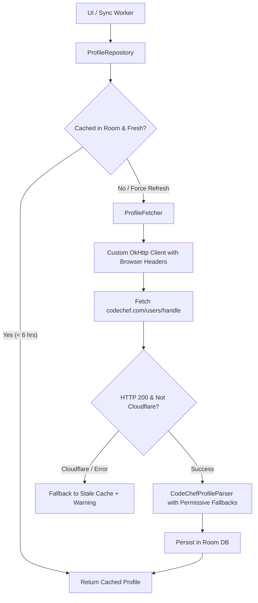

# Technical Specification: Resilient CodeChef Profile Ingestion

**Document Version:** 1.0.0  
**Target:** `app/src/main/java/com/meet11/krono/data/remote/parser/CodeChefProfileParser.kt` & `ProfileFetcher.kt`

---

## 1. Problem Statement
CodeChef lacks an open REST API for user profiles. The current regex scraper frequently fails or marks users as `UserNotFoundException` under the following conditions:
1. **Unrated / New Accounts:** Missing `.rating-number`, rating stars, or global rank DOM elements.
2. **Cloudflare Bot Detection / 403 Forbidden:** Standard OkHttp user-agent headers trigger Cloudflare verification or rate limits.
3. **HTML DOM Variations:** Differences between mobile and desktop web views, or inactive accounts displaying `"Inactive"` instead of a numeric global rank.

---

## 2. Architecture & Design Principles

---

## 3. Key Enhancements

### 3.1 Custom OkHttp Headers (Bypassing Bot Filters)
Add a specialized `OkHttpClient` interceptor for CodeChef requests:
- **User-Agent:** Modern desktop Chrome string (`Mozilla/5.0 (Macintosh; Intel Mac OS X 10_15_7) AppleWebKit/537.36...`).
- **Accept:** `text/html,application/xhtml+xml,application/xml;q=0.9,image/avif,image/webp,*/*;q=0.8`
- **Accept-Language:** `en-US,en;q=0.9`
- **Referer:** `https://www.codechef.com/`

### 3.2 Robust Permissive Parsing (`CodeChefProfileParser`)
1. **Validation Check:**
   - Instead of strictly checking for `user-details-container`, verify absence of explicit 404 text: `if (html.contains("Could not find page") || html.contains("User does not exist")) throw UserNotFoundException`.
2. **Unrated & Zero-Contest Fallbacks:**
   - `rating`: Nullable. If absent, set to `null` or `0` without throwing an exception.
   - `rank`: If rank is absent or text is `"inactive"`, display `"Unrated"` or `"Inactive"`.
   - `maxRating`: Fall back to current rating or `null`.
   - `stars`: If no star badge is found, assign `"Unrated"` instead of failing.
3. **Regex Robustness:**
   - Support both desktop and mobile DOM classes (e.g. `rating-number`, `user-details`, `profileImage`).

### 3.3 Cache-First Resiliency (Room Database)
- **Stale-While-Revalidate:** When a network fetch fails due to Cloudflare or network loss, return the latest cached profile from Room alongside a gentle `SyncStatus.Offline` indicator rather than crashing the UI with a full-screen error.
- **TTL Cache:** Only re-fetch if cache is older than 6 hours unless explicitly pulled-to-refresh by the user.

---

## 4. Verification & Test Suite
- Unit test with saved HTML fixtures:
  - `codechef_7star_sample.html` (Normal active high-rated profile)
  - `codechef_unrated_new_user.html` (0 contests, 0 stars)
  - `codechef_inactive_user.html` (Inactive rank text)
  - `codechef_404_not_found.html` (Throws `UserNotFoundException`)
